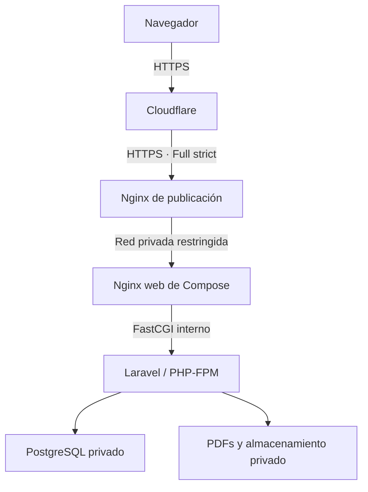

# Laboratorio y publicación mediante Nginx / Cloudflare

Estado: requisitos y plan de puesta en producción. Hay soporte de hosts/proxies/cabeceras en aplicación y plantilla Nginx según [operación de seguridad](operacion-seguridad.md); no configura ni demuestra el servidor. Revisado contra `compose.yml`, `.env.example`, `bootstrap/app.php` y `docker/nginx.conf`; ampliación de seguridad 16/10/2026.

## Topología prevista y límites de confianza

Es un diseño previsto. El Nginx `web` ya existe en Compose; es distinto del Nginx de publicación futuro. TLS de Cloudflare a ese Nginx debe validar certificado con Full (strict). El salto del proxy a Compose puede ser HTTP únicamente en un tramo local/privado restringido y evaluado; si atraviesa una red sin confianza, proteger también ese tramo con TLS o un canal privado seguro.

No habilitar Flexible: no corresponde al esquema cifrado hasta el origen previsto. Un certificado Cloudflare Origin CA sirve para el tramo desde Cloudflare, no sustituye un certificado confiable para acceso directo de navegadores.

La protección de Cloudflare no reemplaza autorización, CSRF, validación y almacenamiento privado de Laravel. El puerto de laboratorio no debe seguir expuesto públicamente como ruta alternativa al proxy.

## Valores y capacidades

| Elemento | Laboratorio de José | Producción prevista |
|---|---|---|
| URL | `http://192.168.112.22:8088` | `https://<dominio-real>`; pendiente |
| APP_URL | Debe corresponder a la URL LAN para enlaces generados | URL HTTPS canónica |
| APP_ENV | Probar con configuración equivalente a producción cuando sea posible | `production` |
| APP_DEBUG | `false` | `false` |
| SESSION_SECURE_COOKIE | `false` mientras el acceso sea HTTP | `true` sobre HTTPS efectivo |
| SESSION_ENCRYPT | `true`, según ejemplo | Mantener `true` |
| SESSION_SAME_SITE | `lax`, según ejemplo | Mantener salvo necesidad justificada y probada |
| Dominio de cookie | Cookie de host si no se configura SESSION_DOMAIN | Host dedicado; no compartir dominio de sesión con otras aplicaciones sin necesidad |
| APP_KEY | Clave persistente de esta instalación | Conservar la clave al promover la misma instalación; otra instalación usa otra clave |
| Puerto 8088 | Solo redes de prueba autorizadas | Loopback si proxy en el mismo host; IP privada y firewall si proxy en otro host |
| PostgreSQL / PHP-FPM | Sin puertos publicados en Compose | Mantener internos |
| MAIL_MAILER | `log` por defecto; no hay envío funcional | No habilitar envío hasta implementar y validar el módulo correspondiente |

El ejemplo `.env` viene con `APP_URL=http://localhost:8088` y bind de loopback: no demuestra qué valores usa el servidor de José. Los valores locales reales se revisan en el servidor sin pegar secretos en tickets o prompts. HTTP de laboratorio no protege el tránsito; limitarlo a la prueba controlada y priorizar datos ficticios.

No introducir variables inventadas como si ya fueran leídas por el código. Se implementan TRUSTED_PROXIES y TRUSTED_HOSTS, vacíos por compatibilidad; requieren valores exactos del destino. No existe ALLOWED_HOSTS. No se debe confiar en *.

## Controles que existen en la base

| Control | Evidencia en código / límite |
|---|---|
| Login y usuario activo | Filament + `EnsureActiveUser`; rutas de documentos requieren sesión |
| Roles de escritura | Servicio de presupuestos autoriza en servidor; recursos comerciales aplican permisos |
| Sesión / CSRF | Middleware nativo; configuración de sesión de Laravel |
| PDF privado y snapshot | Servicio/rutas; archivo conservado con hash y descargas autenticadas |
| Puertos privados | Compose no publica base ni FPM; `web` es la entrada |
| Cabeceras básicas | Nginx interno: nosniff, SAMEORIGIN, Referrer-Policy |
| Ejecución de aplicación | PHP-FPM corre como www-data; no es una certificación de endurecimiento del host |
| Respaldo manual | `scripts/backup.sh`, invocado por actualización; no hay cron/destino externo automático |

## Trabajo pendiente antes de publicar

### P01 · Proxy, HTTPS y host efectivo

Responsable técnico debe levantar la cadena real de saltos y la dirección que recibe Laravel en `REMOTE_ADDR`, incluyendo NAT/puente Docker y FastCGI. Configurar `trustProxies` de Laravel solo para los intermediarios realmente controlados; no usar `*` ni toda la LAN por comodidad.

El Nginx de publicación debe validar el Host y sobrescribir las cabeceras de protocolo/host con los valores correctos del servicio, no aceptar sin control las enviadas por el cliente. Definir qué cabeceras `X-Forwarded-*` son necesarias y sanear las demás. Si se conserva la IP original, confiar en la cabecera de Cloudflare solo cuando la conexión provenga de Cloudflare verificado. Mantener actualizada su lista oficial de redes si se usa para real_ip o firewall. No confiar en `CF-Connecting-IP` desde cualquier origen.

Nginx debe rechazar hosts desconocidos; evaluar también `TrustHosts` en Laravel. `/up` y el healthcheck interno usan hoy un host interno: contemplarlos expresamente al restringir hosts sin abrir acceso externo indiscriminado. `APP_URL` por sí solo no es una lista de hosts autorizados ni configura confianza en proxies.

Aceptación: Laravel reconoce HTTPS, URLs y redirecciones son HTTPS canónicas, cookies Secure/HttpOnly/SameSite correctas, no hay bucles ni contenido mixto; un cliente directo no puede falsificar esquema/host/IP mediante cabeceras arbitrarias. Probar login, logout, Livewire, PDF y redirección de sesión vencida en el recorrido real.

### P02 · Origen restringido y caché

TLS válido y Full (strict) hasta Nginx de publicación. Restringir ingreso al origen a Cloudflare cuando esa sea la única entrada prevista y definir aparte la administración autorizada; considerar autenticación del origen si la topología lo requiere. Decidir entre publicación clásica o túnel antes de aplicar reglas, no mezclar ambas por suposición.

El puerto de Compose solo acepta al proxy. No exponer 5432, 9000, storage privado, `.env`, dumps, logs o endpoints de diagnóstico. HTTPS y firewall se verifican desde una red externa autorizada.

En el hostname de la aplicación, evitar caché compartida de contenido dinámico/autenticado. Bypass en Cloudflare y sin proxy cache para `/app*`, `/livewire*`, `/quotes*` y cualquier ruta de sesión/datos. No aplicar Cache Everything. Los assets públicos con versión pueden tener caché independiente; respuestas de usuarios y PDFs privados no. La aplicación establece Cache-Control private/no-store para aplicación, Livewire, legal y PDF; verificar también que el borde lo respete.

Aceptación: dos sesiones no comparten respuestas ni documentos por caché; una descarga privada no se obtiene sin sesión, y no se llega al sistema saltando el proxy por 8088.

### P03 · Protección interna y operación

- Administración de usuarios/bajas, recuperación y MFA administrativa se implementan en ACC-01…ACC-08; probar SMTP, enrolamiento y revocación en el destino antes de venta externa.
- Revisar límites de peticiones y concurrencia de emisión/PDF; el límite de login no cubre por sí solo el coste de estas operaciones. No bloquear Livewire indiscriminadamente con desafíos del WAF.
- Evaluar CSP primero en modo de reporte, con pruebas de Filament/Livewire. No desplegar una política genérica que rompa la aplicación. HSTS en el borde HTTPS una vez validado el dominio; incluir subdominios/preload solo con evaluación de los demás servicios.
- PostgreSQL privado con credenciales de instalación, permisos revisados y backup verificable. La cuenta creada por la imagen es la del clúster inicial; separar rol de aplicación de privilegios administrativos requiere preparación adicional. No presentar mínimo privilegio de base como completado.
- Secretos fuera de Git y de imagen; acceso de operadores restringido, rotación planificada. La rotación de APP_KEY necesita evaluar cifrado/sesiones/datos, no regenerarla con cada actualización.
- Respaldos cifrados fuera del host, restauración ensayada, retención y responsables. Definir RPO/RTO según operación; todavía no hay valores acordados.
- Logs de acceso/error sin payloads ni credenciales, correlación de incidentes, hora sincronizada y alertas por salud, espacio, errores, backup fallido y certificado. `/up` no reemplaza verificar descarga/PDF/base.
- Zona horaria de negocio: `config/app.php` ya define `America/Asuncion`. Mantenerla en fechas visibles y cálculo de hoy/vigencia, sincronizar la hora del host y verificar límites de día al introducir tareas programadas o cambios de fechas. No inferir la zona de la aplicación a partir de la zona del contenedor.

## Secuencia de promoción y reversión

1. Definir dominio, proxy/host/redes, TLS, datos permitidos, responsables y copia de respaldo; no pedir ni guardar secretos en Git.
2. Implementar P01/P02 y controles pendientes en una rama, con pruebas negativas y compatibilidad de healthchecks.
3. Probar un entorno separado: otro nombre Compose, base, volúmenes, puerto y claves. No cambiar COMPOSE_PROJECT_NAME de una instalación existente esperando conservar sus volúmenes.
4. Registrar commit/release y ejecutar construcción Docker y pruebas contra PostgreSQL, incluyendo dos intentos concurrentes de emitir. SQLite no comprueba bloqueos de fila.
5. Ensayar restauración en un destino aislado y revisar plan de vuelta atrás. Migraciones compatibles no justifican ignorar la compatibilidad de datos con la versión anterior.
6. Publicar la versión validada, actualizar URL/cookies/proxies con procedimiento controlado, limpiar caché/recrear contenedores según cambios de configuración y comprobar el circuito completo.
7. Registrar evidencia y pendientes en `docs/validacion.md`. No marcar publicación segura solo porque el contenedor está Healthy.

## Referencias oficiales

- [Laravel 13 · proxies y hosts](https://github.com/laravel/docs/blob/13.x/requests.md)
- [Cloudflare · Full strict](https://developers.cloudflare.com/ssl/origin-configuration/ssl-modes/full-strict/)
- [Cloudflare · Origin CA](https://developers.cloudflare.com/ssl/origin-configuration/origin-ca/)
- [Cloudflare · direcciones de red](https://www.cloudflare.com/ips/)

Consulta: 15/10/2026. Los requisitos aquí no son evidencia de configuración del servidor.
